<p align="center">
  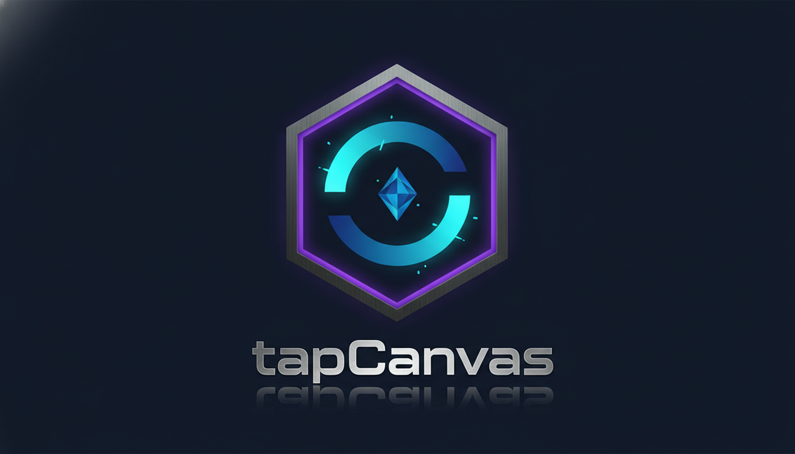
</p>

<h1 align="center">TapCanvas</h1>

<p align="center">
  <a href="https://github.com/anymouschina/TapCanvas/stargazers"></a>
  <a href="https://atomgit.com/gcw_PzejWSbY/TapCanvas" target="_blank" rel="noopener noreferrer"></a>
  <a href="./LICENSE"></a>
</p>

TapCanvas is a multi-model AI content creation platform built around a visual canvas: orchestrate text, image, video and other generation workflows in one place, with fast iteration across multi-step creative pipelines.

**Language:** [中文](README.md) | English

## Demo: From Novel Chapters to Video

Bring chapters, characters, scenes, storyboards and video generation together on one canvas. This demo from the About page uses real canvases from two chapters to show how character and scene assets can be reused across chapters, how alternate appearances and states such as injuries are managed separately, and how the one-click video workflow connects chapter content to video production.

<p align="center">
  <a href="https://lluban.cn/about/">
    
  </a>
</p>

[▶ Watch the full demo](https://lluban.cn/about/) · [Download the demo (MP4)](https://tanvas-ai.tos-cn-guangzhou.volces.com/uploads/user/phone_11dd9f14a3c25ed8947cd76e12fdc0123ea17f972ad99cf25d4d4abcdfda2272/20261014/b3e6665f-3940-43e4-b4b7-df2b50872abf.mp4)

Recorded in the online edition. For the Community Edition's workflow entry points and required model configuration, see [Current architecture](./README.md#当前架构).

## Changelog

The latest 10 entries are shown below; expand the older updates for more history.

- **2026-10-26 · Manual denoise, MCP assistant setup and script export**: Three independent features ported while keeping the community DSH Harness. Manual denoise preserves materials and isolates project style without forcing render styles or promising 8K. MCP setup issues a dedicated key and a copyable assistant prompt; closing the dialog clears the in-memory credential. Select chapters with saved per-clip prompts and export a TXT in chapter/clip order without generating or rewriting scripts.

  Review fixes: exports now share source-book ordering with the chapter list. Added denoise execution and MCP route authorization coverage; 96 targeted tests and the Web type check pass. The full API type check still reports errors in other files. No real generation tasks or external client end-to-end acceptance were performed.

  These are **actual Pro UI reference screenshots from lluban.cn**, not community deployment acceptance. No keys were issued or generation tasks submitted. Surrounding Pro membership/batch-production features are outside this port. The live toolbar currently hides the denoise entry, so no denoise screenshot is claimed. See [delivery notes](docs/deliveries/2026-10-26-manual-tools-sync.md).

  <table width="100%"><tr>
    <td width="50%"><a href="assets/changelog/2026-10-25-mcp-agent-connect-lluban.png"></a></td>
    <td width="50%"><a href="assets/changelog/2026-10-26-script-export-lluban.png"></a></td>
  </tr></table>

- **2026-10-21 · Pipeline and canvas views**: Switch between a creative pipeline and the node canvas for the same project. Five stages—story and script, characters and scenes, storyboard design, video clips, and final film—show existing content, generation status and errors. Storyboards and clips are grouped by scene, with asset filters and media previews. Select a chapter or source text to launch the one-click video workflow, or generate individual items and unfinished assets in the current stage through the canvas execution and prerequisite-asset path.

  Screenshots from the same TapCanvasPro project; click a thumbnail for the full image. **The Community Edition currently runs one chapter at a time. Pro membership tiers, multi-chapter / whole-book batches and the additional specification selectors have not been ported.** The final-film screenshot shows its pending state.

  <table width="100%">
    <tr>
      <td width="25%" align="center"><a href="assets/changelog/2026-10-21-film-chapter-selection.jpg">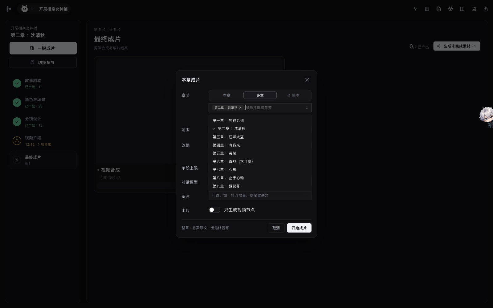</a><br>Chapter selection (Pro reference)</td>
      <td width="25%" align="center"><a href="assets/changelog/2026-10-21-film-options.jpg">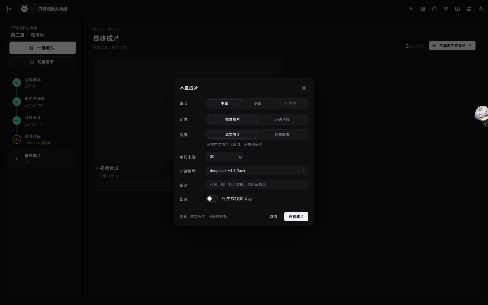</a><br>Film options (Pro reference)</td>
      <td width="25%" align="center"><a href="assets/changelog/2026-10-21-pipeline-script.jpg">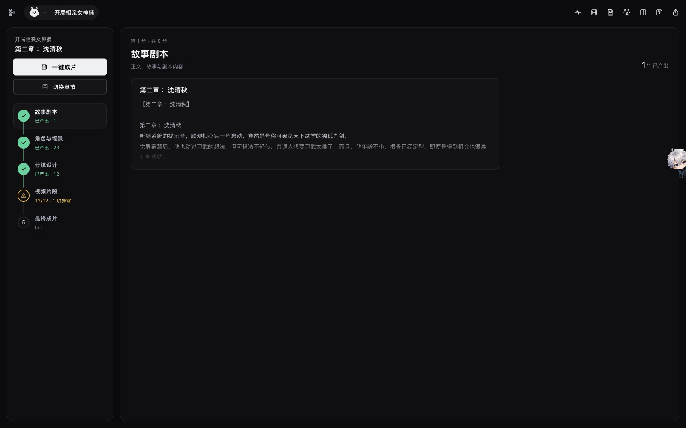</a><br>Story and script</td>
      <td width="25%" align="center"><a href="assets/changelog/2026-10-21-pipeline-overview.jpg">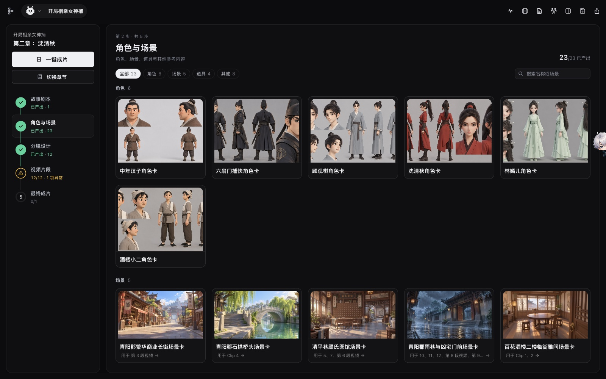</a><br>Characters and scenes</td>
    </tr>
    <tr>
      <td width="25%" align="center"><a href="assets/changelog/2026-10-21-pipeline-storyboard.jpg">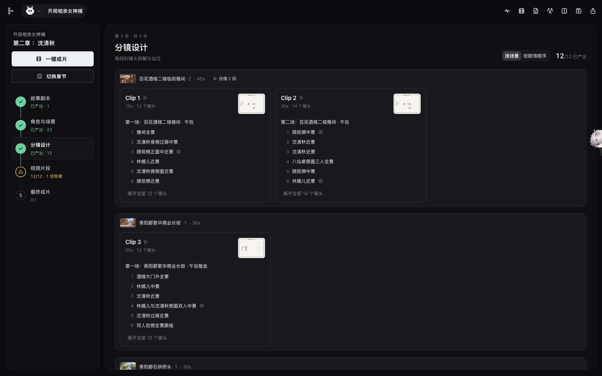</a><br>Storyboard design</td>
      <td width="25%" align="center"><a href="assets/changelog/2026-10-21-pipeline-clips.jpg">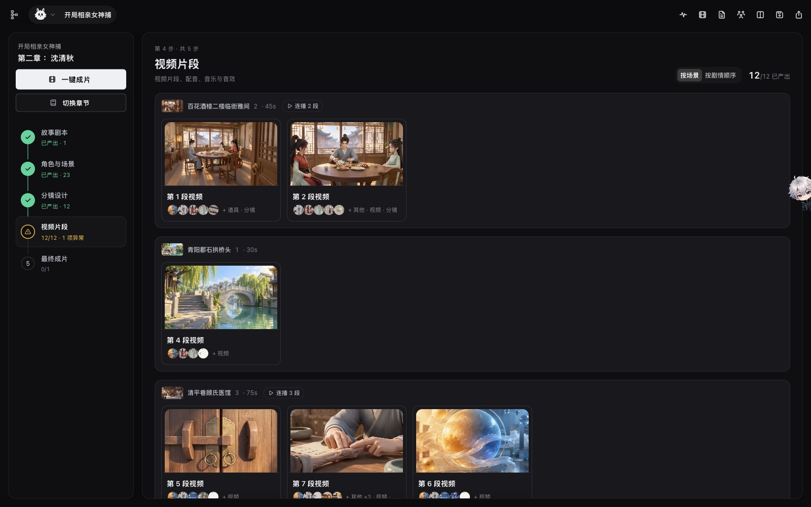</a><br>Video clips</td>
      <td width="25%" align="center"><a href="assets/changelog/2026-10-21-pipeline-delivery.jpg">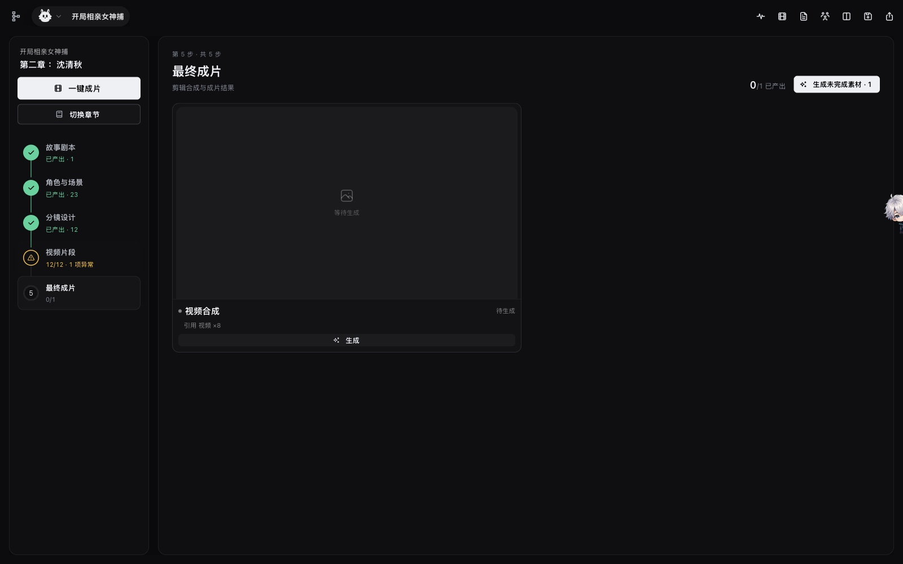</a><br>Final film (pending)</td>
      <td width="25%" align="center"><a href="assets/changelog/2026-10-21-canvas-pipeline-switch.jpg">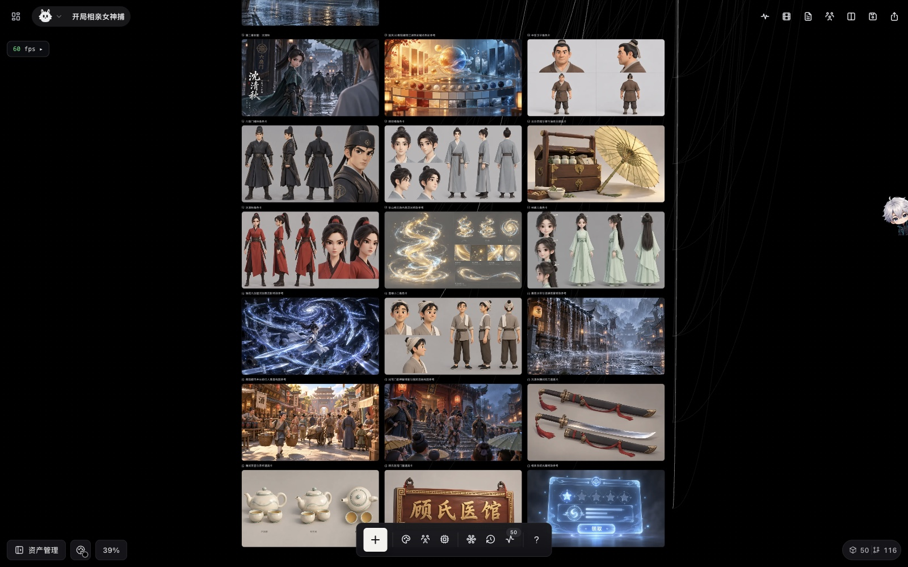</a><br>Node canvas</td>
    </tr>
  </table>

- **2026-10-20 · Image compare node**: New canvas node for comparing images side by side, with a draggable slider, an opacity overlay, or press-to-toggle. Add it from the add-node panel or the context menu, or select two image nodes and click "图片对比" to create and connect it automatically. It follows upstream images live and saves the mode, split position, opacity and size with the node.

  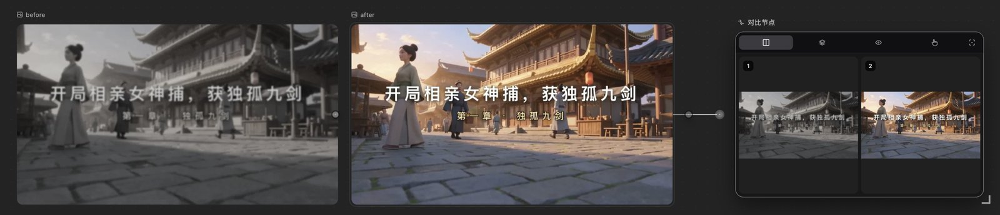
  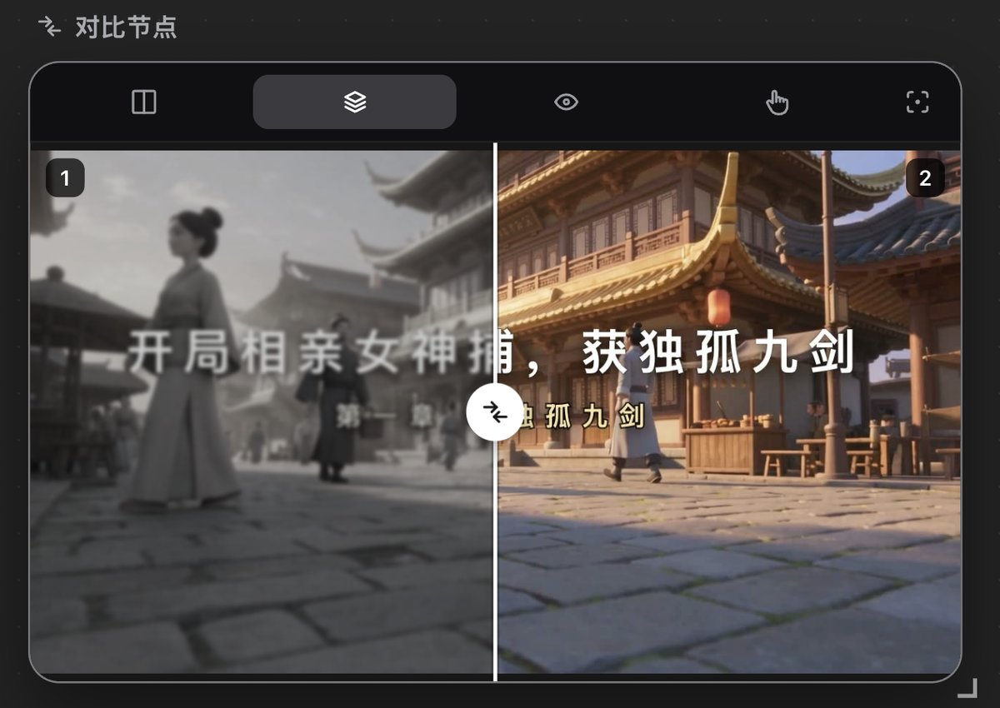

- **2026-10-11 · Factory / Droid account pools**: Ported TapCanvasPro's Droid channel and account management, including key import, account controls and tests, Standard / Core usage windows, subscription details, and same-pool retries after quota rejection. A deployment SQL patch seeds a disabled, empty pool; configure your own keys, model protocols and pricing before enabling it. See [Droid setup](apps/new-api/docs/channel/droid.md).
- **2026-10-07 · One-click video v135**: Synced full-chapter story and timeline planning, asset creation, per-clip prompts and media production, and the latest creative Skills. The editor and executor share the workflow definition and continue to use the Community Edition's DeepSeek Harness Bridge. Added the v135 system workflow release while preserving execution history and generated assets.
- **2026-10-07 · Canvas fixes**: Copying nodes and groups preserves assets and prompts, isolates execution identities and remaps references. Fixed missing assets from visual groups in group downloads.
- **2026-09-23 · Director desk upgrade**: Synced TapCanvasPro's standalone director desk, based on [DirectorDesk](https://github.com/mangfufu/director-desk), for 3D scene blocking, character staging and camera previs. Connected TapCanvas AI chat, tool relay and reference-video export to the canvas, replaced the previous embedded implementation, and added MIT attribution. Web development and production builds now build the director desk automatically; install its standalone dependencies before first use.
- **2026-09-21 · Agent configuration updates**: Added one-click update and replacement for installed workflows after checks pass, retaining their existing scope and confirmed replacement or parallel relationships, along with version history, executions and generated assets.
- **2026-09-21 · Conflict checks**: Shared workflow tools or output formats are now informational rather than forcing a choice. Agents still assess responsibility conflicts; blocking errors and version races are reported explicitly.
- **2026-09-21 · Configuration list fix**: Aligned frontend and backend update-time and first-load-time contracts to fix Agent configuration lists failing to load when time fields were missing. All 94 related configuration-update tests passed.
- **2026-09-21**: Reorganized the project documentation and removed outdated deadlines and capability-completion checklists.

<details>
<summary>Older updates (9 entries)</summary>

- **2026-09-20**: Synced the v90 video production workflow with the DeepSeek Harness runtime. Unified canvas generation actions through the main AI chat and fixed model propagation for chapter asset and design actions, plus local login sessions.
- **2026-09-16**: Added the AtomGit badge, project acknowledgments and contributor information.
- **2026-09-11**: Expanded HeyRoute channels and models, with separate per-channel text, image and video pricing.
- **2026-09-10**: Added HeyRoute channels, the referral registration link and an API key application entry.
- **2026-09-08**: Updated the one-click video implementation and supporting Skills.
- **2026-09-06**: Restored Agent execution-result previews.
- **2026-09-05**: Added Agnes image and video channels, improved model parameter contracts and GPT Image 2 request validation, and fixed video-duration pricing ranges and free reference-image quota calculation.
- **2026-09-04**: Corrected Agnes video generation requests to match the official API contract.
- **2026-09-03**: Improved Docker deployment and dependency builds, including Web and model-console builds inside containers and automatic local configuration and key initialization.

</details>

## Core Capabilities

- **Pipeline / canvas views**: Switch between a node canvas for editing dependencies and a creative pipeline for reviewing scripts, characters and scenes, storyboard designs, video clips and final films. Both views use the same project content, assets and execution records.
- **One-click video entry**: Choose a chapter or source text in the pipeline and submit creative requirements through the text node's production flow. Configure available Agent, image and video model channels and an installed workflow before running. Individual and stage-level generation reuse canvas execution and its prerequisite-asset chain.

## Latest Capabilities

- **Video-to-image reference via frame preview**: drag a frame from the video preview directly onto the canvas to use it as a reference image for image generation.

<p align="center">
  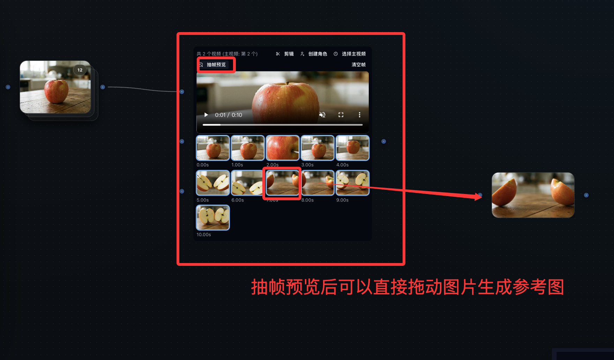
</p>

## HeyRoute referral credit

[Register through our HeyRoute referral link](https://heyroute.ai/r/c/ch_iiq2tvtmrc) to claim **$15 in credits** for Codex, Claude and Gemini chat and the platform's image generation services (eligibility and model availability are subject to HeyRoute's terms).

Seven built-in HeyRoute channels provide 31 models: 15 chat models (Claude, GPT, Grok, Gemini and Kimi), five image models and 11 video models (Grok, MiniMax H3 and Seedance), with per-channel pricing. In the new-api channel list or editor, click **Apply for API Key**, register through the link above, enter your own key and enable the desired channels. New channels start disabled with empty keys; upgrades preserve existing credentials and status. See the [initialization SQL](apps/new-api/patches/2026-09-11/004-expand-heyroute-channels.sql) and [integration notes](apps/new-api/docs/heyroute.md).

## Factory / Droid account pools

Factory / Droid management is built in, with key import and deduplication, per-account controls and tests, usage refresh, subscription details and key expiry. The deployment patch creates a disabled, empty pool. Add your own Factory keys in the gateway console, select models from the dynamic catalog, and configure explicit Droid protocol bindings and pricing before enabling the channel. Reapplying the patch preserves existing accounts and configuration. See [Droid setup](apps/new-api/docs/channel/droid.md).

## Quick Start

### Local dev (recommended)

```bash
# 1) Install deps
pnpm install
npm --prefix apps/director-desk ci

# 2) Configure env
cp apps/web/.env.example apps/web/.env
cp apps/hono-api/.env.example apps/hono-api/.env

# 3) Start (two terminals)
pnpm dev:web
pnpm dev:api
```

`pnpm install` now bootstraps the workspace and generates the Prisma client for `apps/hono-api` automatically. If your environment hits file watcher limits with `pnpm dev:api`, use `pnpm dev:api:stable`.

### One-command full stack (Docker)

The `docker-compose.yml` lives in `apps/hono-api`. Run it from there to start the entire backend stack in one command:

```bash
cd apps/hono-api
docker compose up -d
```

This starts:
- `postgres` — database
- `redis` — cache
- `agents-bridge` — AI chat bridge
- `api` — backend API (`http://localhost:8788`)
- `new-api` — model gateway (`http://localhost:4455`)

Then start the web frontend separately (from the repo root):

```bash
pnpm dev:web
```

Copy env files if you haven't already:

```bash
cp apps/web/.env.example apps/web/.env
cp apps/hono-api/.env.example apps/hono-api/.env
# Then restart if needed
docker compose restart
```

## Architecture / Tech Stack

- **Monorepo**: pnpm workspaces (`apps/`, `packages/`)
- **Web**: Vite + React 18 + TypeScript, Mantine UI, React Flow canvas, Zustand state
- **API**: NestJS (Node.js) + Hono (route reuse), OpenAPI 3.1 + request validation
- **Storage**: SQLite (local), S3-compatible optional for asset hosting

## Environment

- Web (Vite): `apps/web/.env*`
- API: `apps/hono-api/.env` (or `apps/hono-api/.dev.vars`)
- Root `.env.example` is optional (scripts/tools only)

## Verify

- Web: `http://localhost:5173`
- API: `http://localhost:8788`
- API docs: `http://localhost:8788/`

## Docs

- `docs/README.md` (index)
- `docs/docker.md` (Docker)
- `docs/development.md` (local dev)
- `docs/INTELLIGENT_AI_IMPLEMENTATION.md` (AI tool contracts)
- `docs/AI_VIDEO_REALISM_GUIDE.md` (prompt tips)

## TODO / Roadmap

Features planned to be ported from TapCanvas Pro to the community edition:

The review lists **16 features independent of the Pro Agent kernel; F04, F06 and F09 are now implemented**. See [sync TODO](./TODO.md) for IDs, source evidence, existing community capabilities and adaptation boundaries. The original roadmap below is retained; video remake is outside this review's shortlist.

- [x] **Image compare node**: side-by-side / slider / overlay / toggle modes, reading images live from upstream nodes
- [ ] **Video remake**: paste a share link (e.g. Douyin) or upload a video to remake it
- [ ] **Creation composer**: new prompt box with @ asset mentions, attachments, canvas references and per-account model preferences
- [ ] **Video compose + AI subtitles**: multi-clip concatenation, transitions, subtitle styles and chunked subtitle transcription via video-understanding models
- [ ] **Media diagnostics API**: troubleshoot the media pipeline
- [ ] **Changelog dialog**: show what's new in each release inside the app
- [ ] **Product & SEO pages**: public product overview pages and page metadata
- [ ] **parse-video service**: standalone Go service that resolves video links from multiple platforms
- [ ] **TapOps ops panel**: multi-node host metrics, logs and database inventory

Additional sync items (completed items checked; others await selection):

- [x] **F04 Material-preserving manual denoise**: remove forced render styles and unverified 8K claims, and show busy state
- [ ] **F05 Character portrait editing**: appearance/age variants, separate versions and canvas insertion
- [x] **F06 MCP setup through an AI assistant**: issue a dedicated key and copy a setup prompt
- [ ] **F07 CLI / Skill installation**: standalone platform commands, API calls, uploads and subscriptions without the Pro host worker
- [ ] **F08 Inspiration directions**: homepage suggestions, refresh and prompt insertion
- [x] **F09 Multi-chapter script export**: select chapters and export saved per-clip prompts as TXT
- [ ] **F10 Canvas save coordination**: serialized saves and revision confirmation before submission
- [ ] **F11 Dynamic model specifications**: capability fields, reference-image limits and media dimensions

## Built with TapCanvas

Open-source projects built on top of TapCanvas:

| Project | Description |
| --- | --- |
| [JarvisHub](https://github.com/LYL1015/JarvisHub) | An Open Harness for Canvas-Native Multimodal Creative Agents. Treats an editable canvas as shared project state between people and agents for long-horizon creative work (narrative media, interactive web dev, deck generation), with Skills / Memory / Subagents and a bundled Trace Viewer. Apache-2.0. |

> Built something on TapCanvas? Open a PR or issue to get listed here.

## Special Thanks

Thanks to the following platform and open-source projects — TapCanvas' hosting, promotion and implementation are built on them.

- **[AtomGit](https://atomgit.com/gcw_PzejWSbY/TapCanvas) / GitCode** — code hosting, open-source community promotion and badge data; the link above is this project's AtomGit entry.

Upstream open-source projects:

| Project | Role in this repository |
| --- | --- |
| [new-api](https://github.com/QuantumNous/new-api) (upstream: [One API](https://github.com/songquanpeng/one-api)) | Source implementation of the `apps/new-api` model gateway: channel access, metering and model delivery |
| [DirectorDesk](https://github.com/mangfufu/director-desk) | MIT-licensed source of the `apps/director-desk` 3D previs, scene blocking, staging and camera tools |
| [DeepSeek Harness](https://github.com/deepseek-ai/deepseek-harness) | Official runtime, agent loop and tooling for the `apps/agents-cli` bridge |
| [React Flow](https://github.com/xyflow/xyflow) (`@xyflow/react`) | Node, handle and edge kernel of the infinite canvas |
| [Mantine](https://github.com/mantinedev/mantine) | Web UI components and theming |
| [Hono](https://github.com/honojs/hono) | Worker routing and OpenAPI layer of `apps/hono-api` |
| [Prisma](https://github.com/prisma/prisma) | Data models and database access |
| [Vite](https://github.com/vitejs/vite) / [Vitest](https://github.com/vitest-dev/vitest) | Web build and tests |
| [AI SDK](https://github.com/vercel/ai), [Zustand](https://github.com/pmndrs/zustand), [Tabler Icons](https://github.com/tabler/tabler-icons) | Model calls, frontend state management and icons |

Dependency versions follow `apps/*/package.json` and `pnpm-lock.yaml`; every third-party component keeps its own upstream license.

## Contributing

- Issues: https://github.com/anymouschina/TapCanvas/issues
- Discussions: https://github.com/anymouschina/TapCanvas/discussions

## License

MIT

This project has been forked as the TapCanvas **Community Edition**: only non-commercial capabilities will be updated going forward. From open source, for open source.

> **Disclaimer**: The online website is the TapCanvas **Commercial Edition**, which is a separate product from the Community Edition in this repository — they differ in features and scope of service. This license applies only to the code in this repository, not to the online website.
